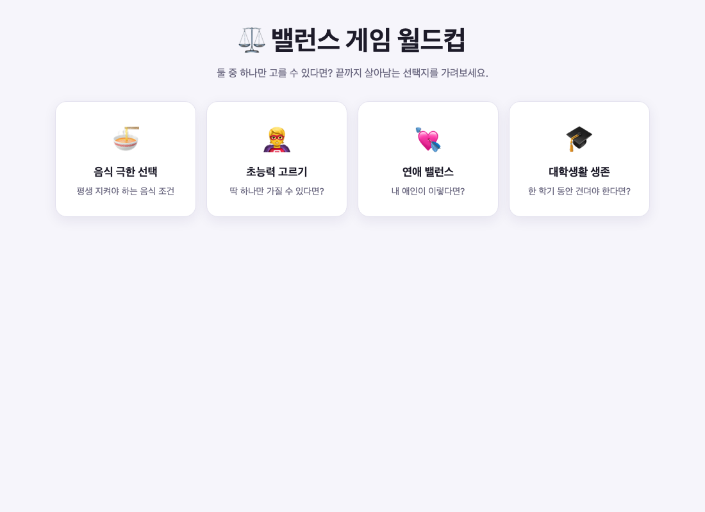
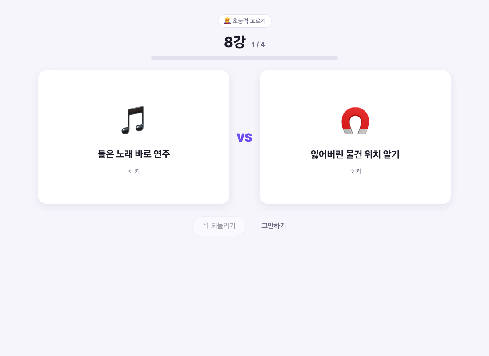
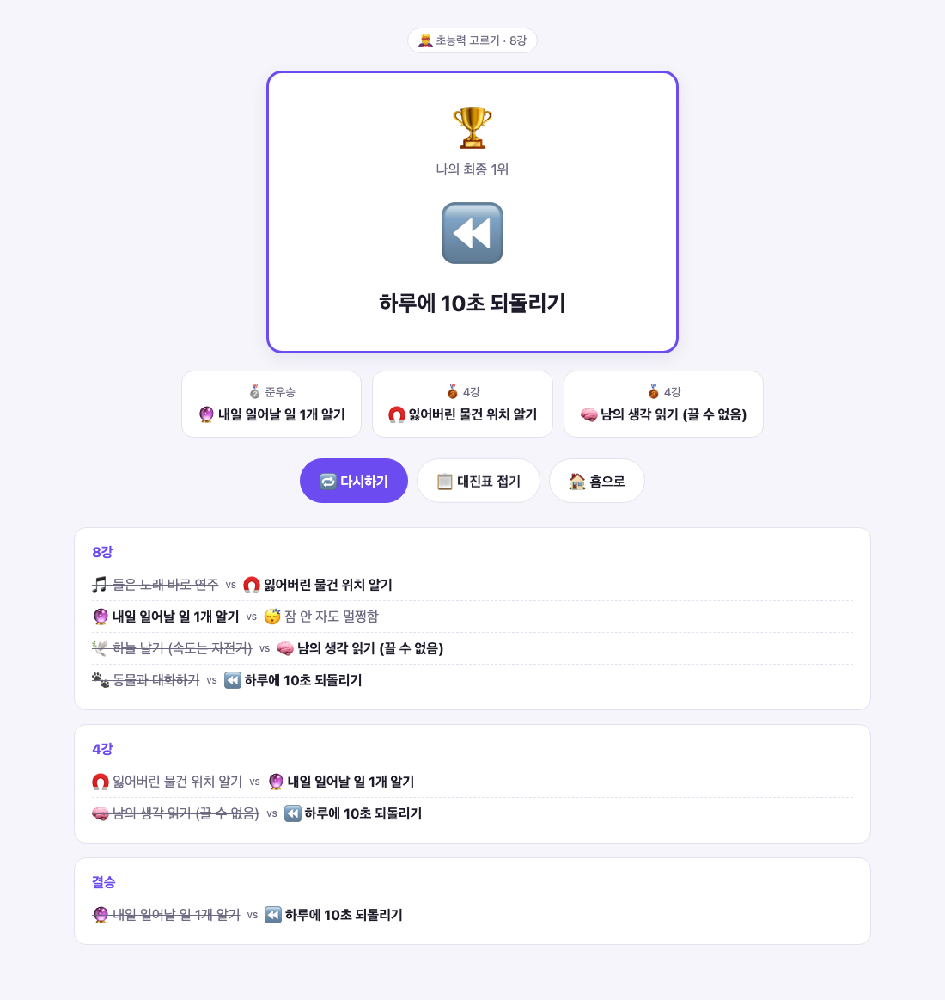
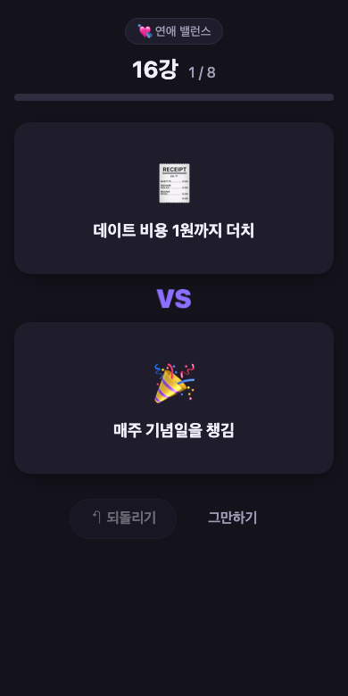

# ⚖️ 밸런스 게임 월드컵

> 둘 중 하나만 고를 수 있다면? 밸런스 게임 선택지들을 **이상형 월드컵 방식의 토너먼트**로 대결시켜 나의 최종 1위를 정하는 웹앱

**▶ 바로 플레이: https://jeong93920.github.io/balance-worldcup/**

| 홈 | 대결 | 결과 + 대진표 | 모바일 (다크 모드) |
|---|---|---|---|
|  |  |  |  |

## 주요 기능
- **주제 4종**: 음식 극한 선택 🍜 / 초능력 고르기 🦸 / 연애 밸런스 💘 / 대학생활 생존 🎓 (주제별 16개 선택지)
- **8강 / 16강 토너먼트**: 매번 무작위로 섞인 대진, 고른 선택지만 다음 라운드로 진출
- **진행 표시**: 라운드 이름(16강 → 8강 → 4강 → 결승), 경기 번호, 진행 바
- **되돌리기**: 직전 선택 취소 (라운드가 넘어간 뒤에도 가능)
- **키보드 조작**: `←` `→` 로 선택, `Backspace` 로 되돌리기
- **결과 화면**: 우승·준우승·4강, 라운드별 전체 대진표, 축하 연출
- **나만의 월드컵**: 선택지를 한 줄에 하나씩 입력해서 직접 만들기 (줄 앞 이모지는 카드 이모지로 사용)
- **나의 기록**: 주제별로 내가 1위로 고른 선택지 TOP 5
- **결과 공유**: 결과를 텍스트로 클립보드에 복사
- 모바일 반응형, 다크 모드, 모션 줄이기 설정 지원

## 기술 스택
- HTML / CSS / Vanilla JavaScript — 빌드 도구·서버 없음
- localStorage — 나만의 월드컵, 기록 저장
- GitHub Pages — 배포

## 프로젝트 구조
```
index.html            진입점
css/style.css         스타일 (라이트/다크, 반응형, 애니메이션)
js/data.js            주제별 밸런스 게임 데이터
js/storage.js         localStorage 저장 (나만의 월드컵, 기록)
js/tournament.js      토너먼트 로직 (셔플, 진출, 되돌리기, 대진표)
js/app.js             화면 렌더링과 이벤트 처리
tests/                토너먼트 로직 테스트
PRD.md / TODO.md      기획서와 작업 목록
```

## 실행 방법
- 온라인: https://jeong93920.github.io/balance-worldcup/
- 로컬: 저장소를 받은 뒤 `index.html`을 브라우저로 열기
- 테스트: `node tests/tournament.test.js`

## 개발 과정
바이브 코딩(AI와 대화하며 개발)으로 제작했습니다. [PRD.md](PRD.md)로 기획을 정리하고 [TODO.md](TODO.md)의 항목을 하나씩 완료할 때마다 커밋·push 했습니다. 진행 과정은 커밋 기록에서 확인할 수 있습니다.
